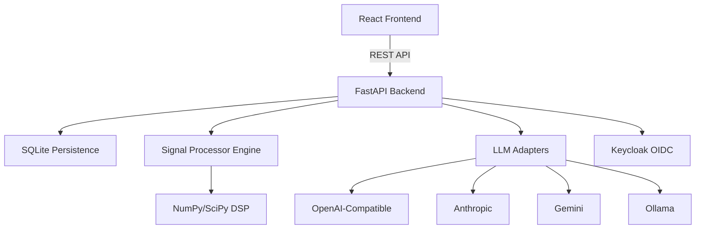

# Signal Lab — Ryan Vo

> Work in progress. This checkpoint may be incomplete or fail tests. See PLAN.md and STATUS.md before use.


Signal Lab | Ryan Vo | AI & Machine Learning

An AI/ML-powered signal processing and analysis platform for developers and researchers. Generate, analyze, and export signals with deterministic DSP algorithms and optional LLM-enhanced insights.

## Problem

Signal processing workflows typically require specialized tools (MATLAB, GNU Radio, custom scripts) that are fragmented, lack reproducibility, and don't integrate with modern AI/ML workflows. Signal Lab provides a unified platform with:

- **Deterministic signal generation**: Sine, square, noise (white/pink/brown), chirp signals
- **Real-time analysis**: FFT, spectrograms, statistical moments, anomaly detection
- **AI/ML integration**: Optional LLM-powered interpretation of signal characteristics
- **Reproducible pipelines**: Persistent storage, versioned exports, audit logging

## Architecture



## Quick Start

### Local Development

```bash
# Backend
python3 -m venv .venv
source .venv/bin/activate
pip install -r backend/requirements.txt
.venv/bin/python -m uvicorn app.main:app --reload --host 127.0.0.1 --port 8000

# Frontend (separate terminal)
cd frontend
npm install
npm run dev
```

### Docker Compose

```bash
docker compose up --build
```

Access:
- Frontend: http://localhost:3000
- Backend API: http://localhost:8000
- API Docs: http://localhost:8000/docs
- Keycloak: http://localhost:8080 (admin/admin)

## Features

### Signal Generation
- **Sine waves**: Configurable frequency, amplitude, phase
- **Square waves**: Adjustable duty cycle
- **Noise**: White, pink (1/f), brown (1/f²) with Voss-McCartney algorithm
- **Chirp**: Linear/logarithmic frequency sweeps

### Analysis Workflows
1. **Frequency Analysis (FFT)**: Magnitude/phase spectra with configurable windows
2. **Time-Frequency (Spectrogram)**: STFT with Hann/Hamming/Blackman windows
3. **Statistics**: Mean, std, RMS, peak-to-peak, skewness, kurtosis
4. **Anomaly Detection**: Global or windowed threshold-based detection

### Export Formats
- **JSON**: Complete signal metadata + data + analyses
- **CSV**: Tabular time-series data
- **WAV**: Audio-compatible (planned)

### AI/ML Evaluation

The platform includes three reproducible ML workflows (to be implemented in future rounds):

1. **Anomaly Detection Baseline**: Statistical thresholding vs. isolation forest on synthetic signals
2. **Signal Classification**: Lightweight CNN for signal type classification (sine/square/noise/chirp)
3. **Denoising Evaluation**: SNR improvement metrics for Wiener/Kalman filters on noisy signals

Run evaluation (when implemented):
```bash
.venv/bin/python -m signal_lab.eval --dataset synthetic --model cnn
```

## API Reference

### Signals

| Method | Endpoint | Description |
|--------|----------|-------------|
| POST | `/api/signals/generate` | Generate new signal |
| GET | `/api/signals` | List signals (paginated) |
| GET | `/api/signals/{id}` | Get signal by ID |
| DELETE | `/api/signals/{id}` | Delete signal |

### Analysis

| Method | Endpoint | Description |
|--------|----------|-------------|
| POST | `/api/signals/analyze` | Run analysis (fft/spectrogram/statistics) |
| GET | `/api/signals/{id}/analyses` | List analyses for signal |
| GET | `/api/signals/{id}/export` | Export signal (json/csv/wav) |

### Example: Generate Sine Wave

```bash
curl -X POST http://localhost:8000/api/signals/generate \
  -H "Content-Type: application/json" \
  -d '{
    "name": "440Hz Tone",
    "signal_type": "sine",
    "sample_rate": 44100,
    "duration": 2.0,
    "frequency": 440,
    "amplitude": 0.5
  }'
```

### Example: Run FFT Analysis

```bash
curl -X POST http://localhost:8000/api/signals/analyze \
  -H "Content-Type: application/json" \
  -d '{
    "signal_id": 1,
    "analysis_type": "fft"
  }'
```

## Configuration

| Variable | Description | Default |
|----------|-------------|---------|
| `DATABASE_URL` | SQLite database path | `sqlite:///./signal_lab.db` |
| `KEYCLOAK_URL` | Keycloak server URL | `http://localhost:8080` |
| `KEYCLOAK_REALM` | Realm name | `signal-lab` |
| `KEYCLOAK_CLIENT_ID` | Client ID | `signal-lab-backend` |
| `KEYCLOAK_CLIENT_SECRET` | Client secret | (required for production) |
| `LLM_PROVIDER` | LLM provider (openai/anthropic/gemini/ollama) | (optional) |
| `LLM_MODEL` | Model name | (optional) |
| `LLM_BASE_URL` | Custom base URL | (optional) |
| `LLM_API_KEY` | API key | (optional) |
| `SECRET_KEY` | JWT secret | (required for production) |
| `DEBUG` | Debug mode | `false` |

## Security

- **Authentication**: OIDC Authorization Code flow with PKCE via Keycloak
- **Session Management**: HttpOnly SameSite cookies with CSRF protection
- **Roles**: `viewer` (read), `operator` (write), `admin` (manage)
- **Production**: Requires HTTPS, proper secrets, non-demo Keycloak config

### Demo Mode

Development includes a demo mode binding to `127.0.0.1` only. Production startup **refuses** demo mode.

```bash
# Demo mode (local only)
DEBUG=true docker compose up

# Production (requires valid config)
DEBUG=false docker compose -f docker-compose.yaml -f docker-compose.prod.yaml up
```

## SSO/SAML Setup

Keycloak supports upstream SAML IdPs through identity brokering:

1. Configure SAML IdP in Keycloak Admin Console → Identity Providers → SAML v2.0
2. Map SAML attributes to Keycloak roles
3. Update realm import in `docker/keycloak/realm-export.json`

## Provider Configuration

| Provider | Base URL | Models | Auth |
|----------|----------|--------|------|
| OpenAI | `https://api.openai.com/v1` | gpt-4, gpt-3.5-turbo | Bearer token |
| Anthropic | `https://api.anthropic.com` | claude-3-opus, sonnet, haiku | x-api-key |
| Gemini | `https://generativelanguage.googleapis.com` | gemini-pro, gemini-pro-vision | API key |
| Ollama | `http://localhost:11434` | llama3, mistral, codellama | None (local) |
| OpenRouter | `https://openrouter.ai/api/v1` | Various | Bearer token |
| LiteLLM | Custom | Various | Bearer token |

## Backup/Restore

```bash
# Backup
docker compose exec backend sqlite3 /app/data/signal_lab.db .dump > backup.sql

# Restore
docker compose exec -T backend sqlite3 /app/data/signal_lab.db < backup.sql
```

## License

MIT © Ryan Vo <ryandtvo@gmail.com>